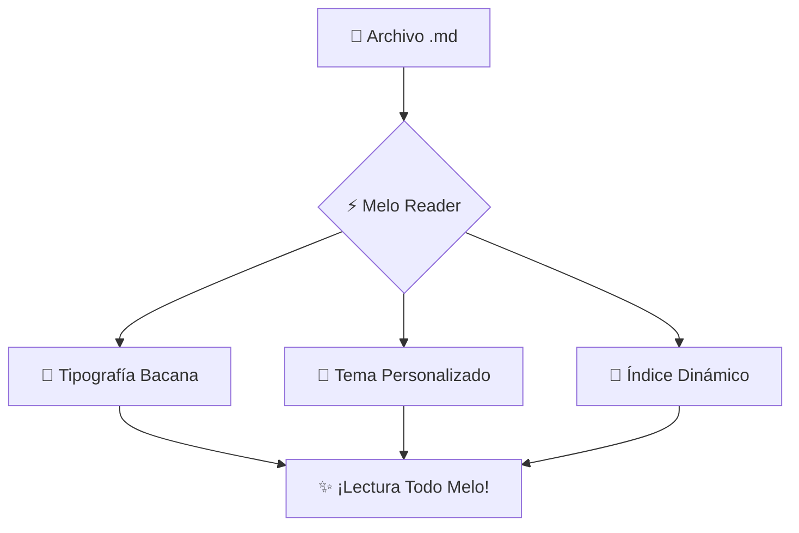

# 🚀 Melo Reader — Tu Lector de Markdown Todo Firme & Bacano

> [!TIP]
> **¡Bienvenido a Melo Reader!** Arrastra y suelta cualquier archivo `.md` en la pantalla, o explora este documento para probar todas las fuentes, temas y funciones que hacen de este lector una experiencia de otro nivel.

---

## ✨ ¿Por qué esta app está tan "Mela"?

Esta no es una aburrida ventana de texto en blanco y negro. Aquí cada detalle fue pensado para que leer tus notas, documentación y artículos técnicos sea un deleite visual:

* 🎨 **Paletas de colores de infarto**: Cyberpunk Neón, Matcha Esmeralda, Catppuccin, Papel Editorial, Obsidian OLED y Synthwave Sunset.
* 🔤 **Tipografías premium**: Desde fuentes ultra-modernas (*Outfit*, *Plus Jakarta*, *Syne*) hasta clásicos editoriales (*Playfair*, *Cinzel*) y fuentes de código (*JetBrains Mono*, *Fira Code*).
* 📑 **Tabla de Contenidos Automática**: Navega por los títulos con un solo clic.
* 📊 **Métricas en tiempo real**: Conteo de palabras, caracteres y tiempo estimado de lectura.
* 🎧 **Lector de voz integrado**: ¡Pásate a modo relax y escucha tus notas!
* 🖨️ **Exportación directa**: Imprime o guarda en PDF con un formato impecable y elegante.

---

## 💡 Callouts & Avisos Especiales

> [!NOTE]
> Este es un bloque de información general para poner apuntes relevantes sin saturar al lector.

> [!TIP]
> Puedes cambiar las fuentes, el tamaño de letra y el ancho del texto desde el menú flotante en la esquina superior derecha.

> [!WARNING]
> Cuidado: Una vez que pruebas leer Markdown con estas fuentes, no vas a querer volver a los editores planos.

> [!CAUTION]
> Asegúrate de guardar tus ideas antes de cerrar la pestaña, aunque tus preferencias se quedan guardadas en tu navegador.

---

## 💻 Bloques de Código con Resaltado y Copiado Rápido

Prueba a pasar el cursor por encima del código y dale clic al botón **"Copiar"**:

```javascript
// Servidor ultrarrápido en Node.js
import http from 'node:http';

const server = http.createServer((req, res) => {
  res.writeHead(200, { 'Content-Type': 'application/json' });
  res.end(JSON.stringify({
    status: 'success',
    vibe: 'Todo Melo caramelo 🍬',
    timestamp: new Date().toISOString()
  }));
});

server.listen(3000, () => {
  console.log('⚡ Melo Reader Server escuchando en http://localhost:3000');
});
```

```python
# Analizador de texto en Python
from dataclasses import dataclass

@dataclass
class Documento:
    titulo: str
    calidad: str = "10/10 Melo"
    
    def resumir(self) -> str:
        return f"Documento: {self.titulo} | Nivel de flow: {self.calidad}"

doc = Documento("Mis Notas Secretas.md")
print(doc.resumir())
```

---

## 📊 Tablas Elegantes

| Característica | Melo Reader | Lectores Tradicionales |
| :--- | :---: | :---: |
| **Fuentes Chéveres** | ✅ Sí (9 familias seleccionadas) | ❌ Solo fuentes del sistema |
| **Temas Estéticos** | ✅ 7 temas vibrantes con modo oscuro/claro | ⚠️ 1 o 2 temas aburridos |
| **Diagramas Mermaid** | ✅ Renderizado automático en vivo | ❌ Código sin procesar |
| **Fórmulas KaTeX** | ✅ Renderizado matemático impecable | ❌ Solo texto plano |
| **Modo Zen / Lectura** | ✅ Enfoque 100% sin distracciones | ❌ Barras llenas de botones |

---

## 📐 Matemáticas y Fórmulas Científicas (KaTeX)

La famosa fórmula de la relatividad especial:

$$E = mc^2$$

Y una integral definida con estilo:

$$\int_{-\infty}^{\infty} e^{-x^2} dx = \sqrt{\pi}$$

O una fórmula en línea como $\sum_{i=1}^{n} i = \frac{n(n+1)}{2}$ integrada naturalmente con el texto.

---

## 🌿 Diagramas en Vivo con Mermaid



---

## 📋 Lista de Tareas Interactivas

- [x] Elegir una fuente bien elegante
- [x] Activar el tema *Cyberpunk Neón*
- [x] Ajustar el ancho del texto a mi gusto
- [ ] Arrastrar mi propio archivo `.md` para leerlo sabroso
- [ ] Compartir Melo Reader con los parceros

---

> *"El buen diseño no se trata solo de cómo se ve, sino de cómo te hace sentir al leerlo."*
> — **Melo Reader Team**
